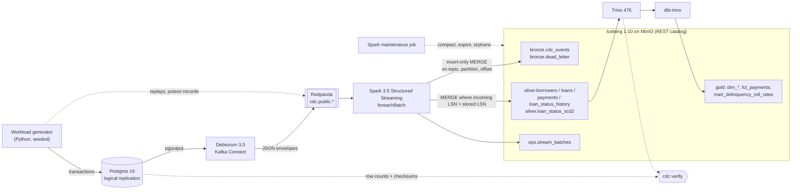
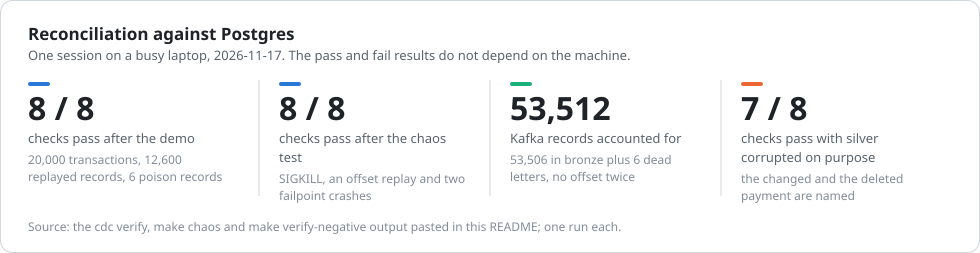

# lakehouse-cdc-streaming

Change data capture from a loan-servicing Postgres database into an Iceberg
lakehouse, with a test harness that proves the lake matches the source after
duplicates, out-of-order delivery, a mid-run schema change, hard deletes and
crashes of the streaming job.

The problem: a servicing system updates loans, payments and borrower records
in place all day. Finance and risk need those tables in the lake within a
minute or so, they need them to be exactly right (a payment applied twice or
a deleted loan that reappears is a reconciliation break), and they need the
history of each loan's delinquency status, which the OLTP tables overwrite.
CDC pipelines usually get the happy path right and go wrong on redelivery,
ordering and deletes. This repository is built around showing that those
cases are handled, by running them and reconciling against the source.

Everything runs locally with one `docker compose` file. Nothing here is
deployed anywhere.

## Architecture

<picture>
  <source media="(prefers-color-scheme: dark)" srcset="docs/img/architecture-dark.svg">
  
</picture>

<details>
<summary>The same diagram as text, with more detail</summary>



</details>

| Layer | Tables | Written by | Contract |
| --- | --- | --- | --- |
| bronze | `cdc_events`, `dead_letter` | streaming job | exactly one row per Kafka record |
| silver | four current-state tables, `loan_status_scd2` | streaming job | equals Postgres row for row once drained |
| ops | `stream_batches` | streaming job | one row per completed micro-batch, with offsets |
| gold | 3 dimensions, 1 fact, 1 mart | dbt | 36 dbt tests |

## Run it

Requirements: Docker with about 6 GB available to it, `uv`, `make`. No Java,
Spark or dbt on the host; `uv` installs the Python tools.

```
make up              # start the stack, seed Postgres, register the connector
make demo            # workload + faults, reconcile, lag report, compaction, reconcile, dbt build
make verify          # drain, then reconcile Postgres against silver (exit 1 on mismatch)
make chaos           # kill the streaming job three ways mid-stream, replay offsets, reconcile
make verify-negative # corrupt silver on purpose and watch verify fail, then roll back
make stop            # stop the containers, keep volumes and data (make up starts them again)
make down            # stop everything, delete volumes
```

Measured on my machine with images already pulled and built: `make up` 51 s,
`make demo` 6 min 48 s, `make chaos` 3 min 48 s. The first `make up` also
pulls the images (about 8.7 GB on disk in total) and builds the Spark image
(downloads the Iceberg and Kafka jars), which depends on your connection. `make help` lists the
other targets (`test`, `test-spark`, `lint`, `maintenance`, `dbt`, `report`,
`trino`, `logs`, `ps`), plus `fmt` (apply ruff fixes and formatting) and
`dbt-docs` (generate dbt docs into `dbt/target`).

Host ports are non-default on purpose: Postgres 15432, Kafka 19092, Kafka
Connect 18083, MinIO 19000/19001, Iceberg REST 18181, Trino 18080, Spark UI
14040. Change them in `.env`.

## What the demo proves

All output below is pasted from one session on 2026-11-17: an Apple Silicon
laptop with 10 cores, Docker limited to 7.75 GiB, and a host load average
between 10 and 15 from unrelated work running at the same time. Treat the
latency and throughput numbers as "this stack, on a busy laptop", not as a
benchmark. The pass/fail results do not depend on the machine.

<picture>
  <source media="(prefers-color-scheme: dark)" srcset="docs/img/results-dark.svg">
  
</picture>

### 1. The workload

`make demo` runs 20,000 transactions with seed 42. The generator is a pure
planner (same seed, same statements and parameters) plus an executor.

```
workload: seed=42 transactions=20000 rate<=250/s id_base=200 schema_change_at=10000
  "elapsed_seconds": 166.0,
  "transactions_per_second": 120.4,
  "by_kind": {
    "burst_update_borrower": 909,     3 updates to one row in one transaction
    "delete_payment": 879,            hard delete + balance correction
    "new_borrower": 1083,
    "originate_loan": 2206,           loan + status history row, one transaction
    "post_payment": 8666,             payment + loan balance (+ payoff status), one transaction
    "purge_loan": 412,                hard delete of a loan, its payments and its history
    "reverse_payment": 857,
    "roll_status": 3282,              delinquency roll or cure + history row
    "schema_change": 1,               ALTER TABLE payments ADD COLUMN channel text, at transaction 10000
    "update_borrower": 1705
  },
  "replayed_records": 12600,
  "poison_records": 6
```

(The annotations on the right are mine; the rest is the manifest the
generator writes to `artifacts/manifest-demo.json`.)

What gets injected on top of normal traffic:

- **Duplicates and out-of-order delivery.** Every 2,500 transactions the
  newest 150 records of every partition of every CDC topic are read back and
  re-published to the same partition in shuffled order: 12,600 extra records
  with old LSNs and new offsets, arriving after newer changes to the same
  keys.
- **Poison records.** Six records that are not valid change events (not JSON,
  truncated JSON, unknown op, no LSN, binary garbage, no primary key), one per
  dead-letter reason.
- **Schema change.** `payments.channel` is added half-way and populated from
  then on.
- **Hard deletes**, single rows and cascades.
- **Snapshot.** 200 borrowers exist before the connector is created, so the
  initial snapshot path (`op = 'r'`) is exercised too.

### 2. Reconciliation after the stream drains

`cdc drain` inserts a marker row in Postgres, waits for it to reach bronze,
then waits until the streaming job has committed past every Kafka high
watermark. `cdc verify` then compares:

```
pipeline drained in 29.3s
PASS  silver.borrowers                       rows pg=1283 silver=1283  checksum pg=27ca76c2e207c25e05:2951648fb65d2619fd silver=27ca76c2e207c25e05:2951648fb65d2619fd  columns=9
PASS  silver.loans                           rows pg=1794 silver=1794  checksum pg=396b09f50356b67799:3919aa7bf5bcbb6a7b silver=396b09f50356b67799:3919aa7bf5bcbb6a7b  columns=13
PASS  silver.payments                        rows pg=6389 silver=6389  checksum pg=c988179fdd4836a79a:c95d407c116d26e077 silver=c988179fdd4836a79a:c95d407c116d26e077  columns=11
PASS  silver.loan_status_history             rows pg=4777 silver=4777  checksum pg=93ee9b74594b16e172:958f500b4f282e197d silver=93ee9b74594b16e172:958f500b4f282e197d  columns=6
PASS  silver.loan_status_scd2                loans compared=1794 versions=4777 deleted loans closed with DELETED=412
PASS  bronze: no duplicate offsets           cdc_events rows=53506 distinct offsets=53506; dead_letter rows=6 distinct offsets=6
PASS  bronze: complete vs Kafka              kafka records=53512 bronze=53506 dead_letter=6
PASS  dead letter: matches injected poison   injected=6 dead_letter=6 missing_lsn=1 missing_primary_key=1 unknown_op=1 unparseable_envelope=3

RECONCILIATION PASSED: 8/8 checks passed
```

How to read it:

- **Row checksums.** Each side renders every column of every row to the same
  canonical text (UTC timestamps at microsecond precision, fixed-scale
  decimals, an explicit NULL marker), hashes the row with MD5, and sums two
  60-bit slices of the hash over the table. Postgres does it in SQL; the lake
  side does it in Trino. The column list is read from Postgres at run time,
  which is why `payments` shows 11 columns: the 10 it was created with plus
  `channel`.
- **SCD2.** The status sequence per loan in `silver.loan_status_scd2`, which
  the pipeline derives from the change stream of `loans.status`, is compared
  with the sequence the application wrote to `loan_status_history` in
  Postgres. Two independent code paths, same 4,777 versions. The 412 purged
  loans end in a `DELETED` version.
- **Bronze.** 53,506 events + 6 dead letters = 53,512 records in Kafka, and
  no offset appears twice. The 53,506 are 40,705 distinct changes, 200
  snapshot rows, 1 drain marker and the 12,600 replayed copies.

### 3. The harness can fail

A test that cannot fail proves nothing, so `make verify-negative` changes one
amount in `silver.payments` by a cent and deletes one row, through Trino:

```
== corrupt silver.payments: +0.01 on payment 291, delete payment 35890
FAIL  silver.payments                        rows pg=12861 silver=12860  checksum pg=1922865fcb2a740c19b:193674978b4111b9ba2 silver=192212ca8cfcdedc03c:19359398104d980587d  columns=11
        1 keys in Postgres, missing in silver: 35890
        1 keys present in both, content differs: 291
RECONCILIATION FAILED: 7/8 checks passed
== roll silver.payments back to snapshot 6020402023190620291, verify must pass
RECONCILIATION PASSED: 8/8 checks passed
NEGATIVE TEST PASSED: the corruption was detected and located
```

`cdc verify` exits 1 on any failed check. The rollback is Iceberg's
`rollback_to_snapshot`.

### 4. Chaos test

`make chaos` runs a second 20,000-transaction workload (seed 7) and, while it
is running, breaks the streaming job in three different places and replays a
Kafka offset range:

```
== A. SIGKILL the streaming container, keep it down for 10s
streaming job exited with code 137
restarted from the checkpoint; next batch committed

== B. replay Kafka offsets 0..1500 of every partition of the loans and payments topics
replayed 4500 records to cdc.public.loans
replayed 4500 records to cdc.public.payments

== C. failpoint: exit after the bronze commit, before any silver merge
streaming job exited with code 86
on disk now:   batch 26: 15161 rows in bronze; NOT recorded as complete (interrupted) in ops.stream_batches
after restart: batch 26: 15161 rows in bronze; recorded as complete in ops.stream_batches

== D. failpoint: exit after the loans merge, while the other silver merges are in flight
streaming job exited with code 86
on disk now:   batch 27: 19991 rows in bronze; NOT recorded as complete (interrupted) in ops.stream_batches
after restart: batch 27: 19991 rows in bronze; recorded as complete in ops.stream_batches

== drain and reconcile
pipeline drained in 35.9s
PASS  silver.borrowers                       rows pg=2338 silver=2338  checksum pg=4971a4a01c6c6101ae:49cc9b4aeae80a8048 silver=4971a4a01c6c6101ae:49cc9b4aeae80a8048  columns=9
PASS  silver.loans                           rows pg=3581 silver=3581  checksum pg=717f6644919fe665e5:7149d2829d57eb65d0 silver=717f6644919fe665e5:7149d2829d57eb65d0  columns=13
PASS  silver.payments                        rows pg=12861 silver=12861  checksum pg=1922865fcb2a740c19b:193674978b4111b9ba2 silver=1922865fcb2a740c19b:193674978b4111b9ba2  columns=11
PASS  silver.loan_status_history             rows pg=9488 silver=9488  checksum pg=1299cab32d864cdfad4:12996ada3a3f24b1138 silver=1299cab32d864cdfad4:12996ada3a3f24b1138  columns=6
PASS  silver.loan_status_scd2                loans compared=3581 versions=9488 deleted loans closed with DELETED=847
PASS  bronze: no duplicate offsets           cdc_events rows=116072 distinct offsets=116072; dead_letter rows=13 distinct offsets=13
PASS  bronze: complete vs Kafka              kafka records=116085 bronze=116072 dead_letter=13
PASS  dead letter: matches injected poison   injected=13 dead_letter=13 missing_lsn=2 missing_primary_key=2 unknown_op=2 unparseable_envelope=7

RECONCILIATION PASSED: 8/8 checks passed

CHAOS TEST PASSED
```

Steps C and D are the interesting ones. A random `kill -9` almost always
lands inside a Spark job, where nothing has been committed yet. The damaging
window is between two Iceberg commits of the same micro-batch, so the job has
named failpoints that `os._exit` there on request (`streaming.py`,
`failpoint()`). In step C batch 26 is in bronze and in no silver table when
the process dies. After the restart Spark re-runs batch 26 with the same
offsets: bronze still has 15,161 rows (the insert-only MERGE added nothing),
silver catches up, and the checksums match. The script fails if a failpoint
does not fire or the exit code is not the expected one.

(Excerpt; the full output also has the workload summary and the lag report.
The 13 dead letters are the 6 from the demo, 6 new ones, and 1 poison record
that was inside a replayed range and so was delivered twice.)

### 5. Lag and freshness

From the demo run (`cdc report`):

```
consumer lag (records)   samples=44 p50=4051 p95=8399 max=12196 last=0
freshness (seconds)      events=40705 p50=15.5 p95=38.6 p99=42.6 max=43.4
micro-batches            count=22 records=53512 p50=5.8s p95=16.9s max=31.3s largest=7499 records
streaming throughput     288 records/s while a batch is running (186s busy)
```

- **Consumer lag** is Kafka high watermark minus the offset the job has
  committed to the lake, summed over partitions, sampled every 3 s while the
  workload runs.
- **Freshness** is measured per change event: commit time in Postgres
  (`source.ts_ms`) to the end of the micro-batch that merged it into silver.
  All 40,705 changes are in the distribution; replayed copies count once, at
  first delivery.
- The 31 s maximum batch is the second batch after a cold JVM start.

During the chaos run the same report shows what the outages cost: lag
p95 41,952 records, freshness p50 73.7 s and p95 101.1 s over 40,964 events,
six large batches (largest 19,994 records) at 463 records/s. Lag returned to
0 before the reconciliation.

In an earlier run in the same session, with replays and poison injection
turned off, three consecutive steady-state batches of 4,676 to 6,228 records
took 7.5 to 9.2 s each. I have not measured this on an idle machine or on
real cluster hardware.

### 6. Table maintenance

`make maintenance` (also step 4 of the demo) pauses the stream, runs
`rewrite_data_files`, `rewrite_position_delete_files`, `rewrite_manifests`,
`expire_snapshots` and orphan-file removal on every table, and fails if a
table's row count changes. After the demo workload:

```
table                          data files  delete files          data KB   snapshots  files expired  orphans removed  seconds
-----------------------------------------------------------------------------------------------------------------------------
bronze.cdc_events               77 -> 5        0 -> 0       3207 -> 2660     22 -> 3                21                0     66.5
bronze.dead_letter               6 -> 1        0 -> 0         22 -> 4         6 -> 3                 5                0     11.5
silver.borrowers                16 -> 1       14 -> 0        162 -> 39       17 -> 3               135                0     13.5
silver.loans                    15 -> 1       14 -> 0        346 -> 75       19 -> 3               110                0      8.5
silver.payments                 15 -> 1       13 -> 0        393 -> 256      21 -> 3               129                0     14.0
silver.loan_status_history      15 -> 1       13 -> 0        146 -> 77       19 -> 3               119                0      5.5
silver.loan_status_scd2         15 -> 1       14 -> 0        149 -> 90       19 -> 3               121                0      5.8
ops.stream_batches              22 -> 1        0 -> 0         80 -> 5        22 -> 3                21                0      8.4
```

The reconciliation is run again afterwards and passes with the same
checksums. Bronze ends at 5 files because it is partitioned by source table
and day and there are 5 tables.

Orphan files are what a killed writer leaves behind. After the chaos run the
same job reported 8 orphan files removed from `silver.borrowers`: files
written by a merge that was killed before it committed, and written again by
the retry.

### 7. Gold layer

```
Found 9 models, 36 data tests, 5 sources, 500 macros
Finished running 5 table models, 36 data tests, 4 view models in 0 hours 0 minutes and 10.57 seconds (10.57s).
Done. PASS=45 WARN=0 ERROR=0 SKIP=0 NO-OP=0 TOTAL=45
```

`dim_borrower`, `dim_loan`, `dim_loan_status_history` (type 2),
`fct_payments` (one row per payment, with the loan's status at the moment of
payment looked up in the type 2 dimension) and
`mart_delinquency_roll_rates`. Tests: unique, not_null, relationships and
accepted_values, plus four singular tests (payment components sum to the
amount, status intervals tile time with exactly one current version, roll
rates sum to 1, and `dim_loan.current_status` agrees with the type 2
dimension, which is built by a different code path). `make dbt-docs`
generates the dbt docs site into `dbt/target`.

### 8. Tests that do not need the stack

```
$ make test          # pure Python, 0.5 s
106 passed in 0.53s
$ make test-spark    # Spark sinks on a local Iceberg catalog, inside the Spark image
15 passed in 48.46s
$ make lint
All checks passed!
39 files already formatted
```

`src/lakehouse_cdc/reference.py` is a small pure-Python model of the merge
rules. The unit tests check its properties (every permutation of a key's
history converges, duplicates are no-ops, a stale update cannot resurrect a
deleted row). The Spark tests feed the same events to the real
`foreachBatch` function in shuffled order, split into random batches, with
duplicates and re-executed batches, and require the Iceberg tables to equal
what the model computes. The envelope parser exists twice for the same reason
(Python specification, Spark SQL implementation) with a parity test over 33
inputs.

## Design decisions and trade-offs

The ADRs in `docs/adr/` have the full reasoning. Short version:

**Spark `foreachBatch` + `MERGE`, not Flink, not the Kafka Connect Iceberg
sink** ([ADR 0001](docs/adr/0001-spark-foreachbatch-merge.md)). The merge
condition is the correctness logic, and `MERGE INTO ... WHEN MATCHED AND
s._lsn > t._lsn` states it in one place that can be unit-tested. Flink's
Iceberg upsert mode has no "only if newer" condition; the Connect sink has no
conditional upsert at all and would cover bronze only. The price is
micro-batch latency: seconds, not milliseconds.

**Effectively-once by idempotence, not by transactions**
([ADR 0002](docs/adr/0002-effectively-once.md)). A batch writes to up to
eight tables and Iceberg has no cross-table transaction. Rather than pretend,
every write is safe to repeat and the checkpoint guarantees a failed batch is
repeated with the same offsets. Bronze is deduplicated on Kafka coordinates,
silver on LSN.

**LSN ordering, not timestamps**
([ADR 0003](docs/adr/0003-lsn-ordering-and-tombstones.md)). Commit timestamps
are millisecond resolution and collide; `updated_at` is client-set and absent
on deletes. The LSN is unique per change and, because of row locks, monotonic
per key even when transactions interleave.

**Deletes are tombstones in silver.** With hard deletes, a late update for a
deleted key would find no stored LSN to lose against and would re-insert the
row. Tombstones are purged by the maintenance job after a retention.

**Iceberg, merge-on-read for silver**
([ADR 0004](docs/adr/0004-iceberg-merge-on-read.md)). Spark and Trino both
use it natively and the REST catalog makes local and Glue look alike.
Copy-on-write would rewrite every data file a batch touches; merge-on-read
writes small delete files and leaves the cleanup to compaction, which is why
compaction is part of the repo. Gold is rebuilt in full by dbt, effectively
copy-on-write, because it is read-heavy and rebuilt rarely.

**JSON with embedded schemas locally, Avro and a registry in production**
([ADR 0005](docs/adr/0005-json-envelope-and-schema-evolution.md)). Embedded
schemas let the job detect a new column and its type with no extra service.
They also make every message several times larger than it needs to be.

**SCD2 recomputed per affected key from the change stream**
([ADR 0006](docs/adr/0006-scd2-from-cdc.md)). "Close the current row, insert
a new one" is only right when events arrive in order. Recomputing the
intervals for the touched loans from all their versions is right in any
order. It needs the before image, so `loans` (only) has
`REPLICA IDENTITY FULL`.

**Redpanda instead of Kafka locally.** One binary, no JVM, starts in seconds
and runs in 700 MB. The job only uses the Kafka protocol; on AWS it is MSK
(`infra/terraform`). Nothing Redpanda-specific is used except `rpk` in the
health check.

**One streaming query for all tables.** Simpler to operate and a single
checkpoint. The silver merges inside a batch run concurrently because the
tables are independent. The cost is coupling: a slow table slows the others.

**A crash-only job.** There is no graceful shutdown. Stopping the container
and killing it go through the same recovery path, so that path is the one
that gets exercised every day.

## Failure modes

| Failure | What happens | Evidence |
| --- | --- | --- |
| Streaming job killed mid-batch | Restart re-runs the batch from the checkpointed offsets; all sinks are idempotent | chaos A |
| Crash after bronze commit, before silver | Same; bronze insert-only MERGE adds nothing the second time | chaos C, `test_reexecuted_batch_changes_nothing` |
| Crash between silver table commits | Same; tables already merged reject the re-applied events on LSN | chaos D |
| Kafka Connect redelivers, or someone rewinds the connector | Copies land in bronze (they are distinct Kafka records) and are no-ops in silver | demo replays, chaos B |
| Stale event arrives after a newer one | LSN guard rejects it | demo replays (shuffled), Spark permutation tests |
| Stale update arrives after a delete | Tombstone holds the delete's LSN; update rejected | `test_stale_update_after_delete_does_not_resurrect` |
| Unparseable or malformed record | Routed to `bronze.dead_letter` with a reason and the raw bytes; the batch continues | demo: 6 injected, 6 dead-lettered |
| New column at the source | `ALTER TABLE ADD COLUMN` on silver before the merge; older rows stay NULL | demo: `payments.channel` |
| Type change, rename, `ADD COLUMN ... DEFAULT` | Not automatic; see runbook section 3 | not exercised |
| Kafka retention removes offsets the job still needs | `failOnDataLoss=true`: the job stops instead of skipping silently | not exercised |
| Connector down, replication slot retains WAL | `max_slot_wal_keep_size` bounds it; runbook section 2 | not exercised |
| Small files accumulate | Maintenance job; runbook section 4 | demo step 4 |
| Someone edits silver by hand | `cdc verify` names the keys; `rollback_to_snapshot` | `make verify-negative` |
| Iceberg catalog container restarts | Catalog state is on a volume (SQLite); tables survive | restarted during development, not part of an automated test |

## What changes at 100x

The demo is about 250 changes per second into tables of thousands of rows.
At 25,000 per second into tables of hundreds of millions:

- **Merges stop being cheap.** An unpartitioned `MERGE` scans the whole
  target for matches. Bucket silver tables on the primary key so a batch only
  reads the buckets it has keys for, and enable storage-partitioned joins.
  Sort within files on the key so min/max statistics prune.
- **One query becomes several.** One streaming query per table (or per group
  of tables with similar volume), each with its own checkpoint, so they scale
  and fail independently. The code is already per-table inside the batch.
- **Bronze stops using MERGE.** The insert-only merge is a join per batch. At
  volume, bronze should be a blind append made idempotent by recording the
  batch id in the snapshot summary, or handed to the Kafka Connect Iceberg
  sink, with duplicates tolerated because silver deduplicates anyway.
- **Compaction runs alongside the stream.** Pausing is no longer acceptable.
  Compact partitions or buckets the stream is not currently writing, with
  partial progress, on its own schedule and cluster.
- **Avro and a schema registry** replace JSON with embedded schemas. That is
  most of the bytes on the wire today.
- **Kafka gets real sizing.** Partition counts from throughput, replication
  factor 3, retention longer than the worst outage you intend to survive
  without a re-snapshot.
- **The SCD2 recompute** reads the stored versions of every touched loan. It
  stays proportional to the batch as long as the table is bucketed on
  `loan_id`; unbucketed it becomes a full scan per batch.
- **Reconciliation cannot wait for a drain.** On a system that never goes
  quiet, compare as of a point: an LSN cut on the Postgres side (a
  repeatable-read snapshot whose LSN is known) and silver filtered to
  `_lsn <=` that cut, per key range, on a schedule, alerting on drift.
- **The source is protected.** Debezium on a read replica where the Postgres
  version allows it, slot lag alerting, and heartbeats that write.
- **Spark runs on a cluster**, with the checkpoint in object storage and the
  state of the job (lag, batch duration, dead-letter rate) exported as
  metrics rather than read from a table by a script.

## Resource budget

Memory limits are set on every container. Limits and what `docker stats`
showed after the chaos run in this session:

| Service | Limit | Observed |
| --- | --- | --- |
| postgres | 300 MiB | 34 MiB |
| redpanda (`--smp 1 --memory 700M`) | 900 MiB | 511 MiB |
| connect (heap 640 MB) | 1000 MiB | 470 MiB |
| minio | 400 MiB | 246 MiB |
| iceberg-rest (heap 192 MB) | 400 MiB | 184 MiB |
| trino (heap 1 GB) | 1800 MiB (raised from 1600 after seeing this) | 1458 MiB |
| streaming (Spark local[4], heap 1100 MB) | 1900 MiB | 723 MiB just after a restart; 1.56 GiB RSS under load |

About 4.5 GiB in use with the stream busy. The limits add up to 6800 MiB
(about 6.6 GiB, counting the 100 MiB limit of the one-shot `minio-init`), more
than that because they are ceilings, not reservations.

The Spark container needed explicit caps on metaspace, code cache and direct
memory (`docker/spark/spark-defaults.conf`). With a 1300 MB heap and no caps
the container sat at its limit (the cgroup counters showed 385 limit events
and 141 MB swapped) and batches that had taken about 4 s were taking 15 to
20 s. The fix was a smaller heap, the caps, and not starting Python worker
processes from the driver. Host load was a second factor in that slowdown and
I did not separate the two.

## Known limitations

Things that are not done, not verified, or true only with a caveat.

- **Single node, no HA.** One broker with replication factor 1, one Connect
  worker, Spark in local mode in one container, the Iceberg REST fixture image
  with a SQLite file behind it. The fixture is a test catalog, not something
  to run in production.
- **The checkpoint is on a local Docker volume**, not in object storage.
- **Out-of-order delivery in the compose run comes from replays**, that is,
  records that were already delivered once. Debezium keys records by primary
  key, so first deliveries arrive in order per key. First-delivery disorder
  is covered by the Spark tests and unit tests (shuffled input), not by the
  end-to-end run.
- **Performance numbers are from a busy laptop** and vary run to run with
  whatever else the host is doing. There is no number here for an idle
  machine or a real cluster, and no tuning beyond what is described under
  "Resource budget".
- **Freshness is bounded by the micro-batch**, and its resolution is the
  millisecond `source.ts_ms`.
- **LSN ordering assumes a single Postgres timeline.** After a failover or a
  restore, LSNs can go backwards relative to what silver stored and new
  changes would be rejected. Not handled.
- **Schema evolution is additive only.** Type changes and renames need a
  person. `ADD COLUMN ... DEFAULT` back-fills rows without WAL events and
  would fail the reconciliation until an incremental snapshot is run. A new
  `NUMERIC` column arrives as `string`.
- **`TRUNCATE` is not replicated.** The event is dead-lettered as
  `unknown_op`.
- **Tombstones are purged after 7 days by default.** A replay older than the
  retention can resurrect a deleted row.
- **Cross-table consistency is eventual.** Tables are committed one at a
  time. dbt relationship tests can fail if run while the stream is in the
  middle of a batch; the demo runs dbt after a drain.
- **Maintenance pauses the stream.** Running both concurrently is described
  in the runbook but not implemented or tested here.
- **The reconciliation needs a quiet source** (it drains first). An as-of-LSN
  comparison for a live system is described above, not built.
- **Generator determinism covers the plan**: statements and parameters. Row
  timestamps use the database clock, and which Kafka records a replay picks
  up depends on timing, so bronze row counts differ slightly between runs of
  the same seed. Silver row counts for a seed are stable for a fresh stack.
- **Consumer lag is derived** from `ops.stream_batches`, because the Spark
  Kafka source does not commit to a consumer group. Standard Kafka lag tooling
  will not see this job.
- **CI has not run.** `.github/workflows/ci.yml` passes `actionlint`, and I
  ran every command it contains locally, but there is no GitHub repository
  yet and so no workflow run.
- **Terraform is a reference.** `terraform fmt -check` and
  `terraform validate` pass (in the `hashicorp/terraform:1.9` image). It has
  never been planned or applied against an AWS account.
- **MinIO image.** MinIO no longer publishes images on Docker Hub. The stack
  uses the Chainguard build of upstream MinIO pinned by digest; if that digest
  is ever garbage-collected, any S3-compatible store works with the same
  settings.
- **Security is out of scope locally.** Development passwords in
  `.env.example`, no TLS, no authentication on Trino, Connect or Redpanda.
- **`make stop` followed by `make up` has not been run.** `make up` skips the
  seed when Postgres already has data and updates the connector in place, so it
  should resume from the kept volumes, but only `make down` and a fresh
  `make up` have been exercised.
- **Tested on macOS (Apple Silicon) with Docker Desktop only.** All images are
  multi-arch, but I have not run it on x86 Linux.

## Repository layout

```
docker-compose.yml            the whole stack, memory limits on every service
Makefile                      up / demo / verify / chaos / maintenance / dbt / test / lint / down
docker/
  postgres/init/              OLTP schema, publication, least-privilege CDC role
  connect/loans-cdc.json      Debezium connector config
  spark/                      Spark image (Iceberg + Kafka jars), spark-defaults.conf
  trino/                      Trino config and the Iceberg catalog
src/lakehouse_cdc/
  contracts.py                silver table contracts, shared by Spark and the tools
  envelope.py                 Debezium envelope parsing + dead-letter rules (specification)
  reference.py                pure-Python model of the merge and SCD2 semantics
  schema_evolution.py         which columns to add, and with what type
  generator/planner.py        deterministic workload plan
  generator/executor.py       runs the plan against Postgres
  inject.py                   Kafka replays and poison records
  poison.py                   the poison records, one per dead-letter reason
  clients.py, config.py       Postgres / Trino / Kafka helpers, settings from .env
  drain.py                    wait until Postgres commits have reached silver
  verify.py                   reconciliation
  observe.py                  lag, freshness, batch statistics
  cli.py                      the `cdc` command
  sparkjobs/
    streaming.py              the streaming job (foreachBatch, failpoints)
    envelope_sql.py           envelope parsing in Spark SQL
    sinks.py                  idempotent bronze / silver / SCD2 writes
    tables.py                 Iceberg DDL
    maintenance.py            compaction, expiry, orphan files, tombstone purge
scripts/                      demo.sh, chaos.sh, maintenance.sh, verify_negative.sh
dbt/                          dbt-trino project: staging views, gold tables, tests
tests/unit/                   pytest, pure Python (106 tests)
tests/spark/                  pytest inside the Spark image (15 tests)
infra/terraform/              AWS reference: S3, Glue, MSK Serverless, IAM
docs/adr/                     six architecture decision records
docs/runbook.md               on-call runbook
.github/workflows/ci.yml      lint, unit tests, dbt parse, terraform validate, Spark tests, integration
```

## License

MIT, see [LICENSE](LICENSE). Copyright (c) 2026 Linus Dominic Nathaniel.
